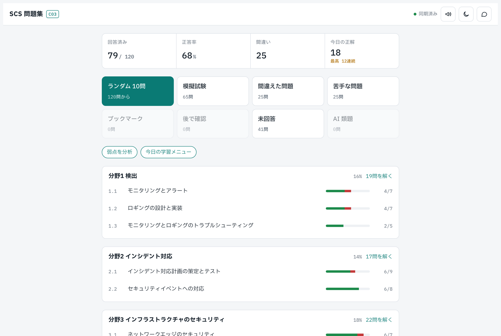
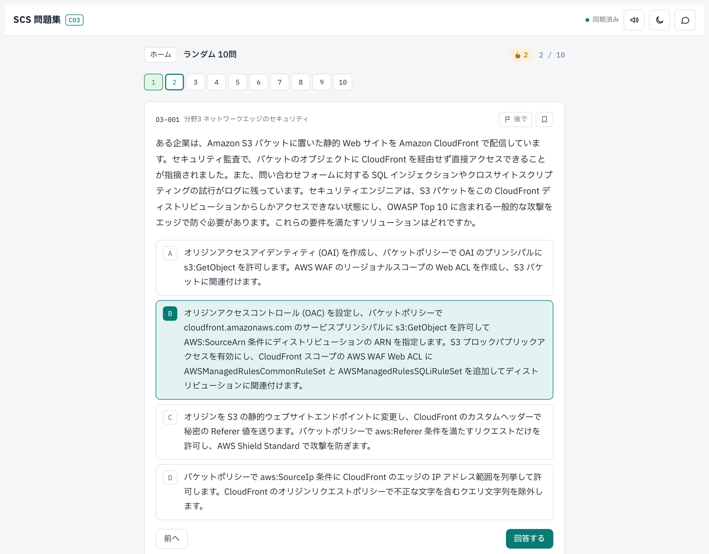
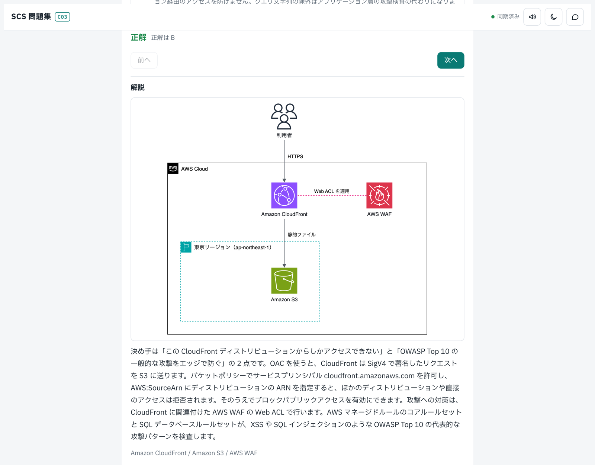
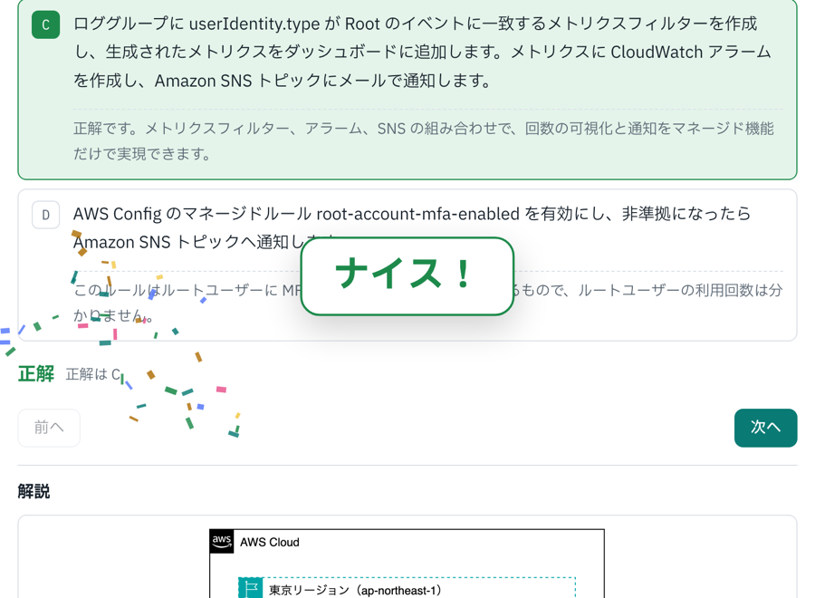
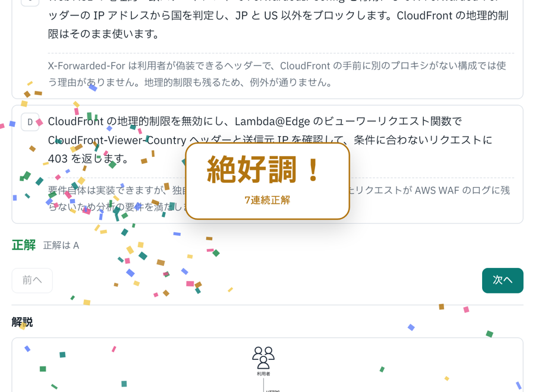
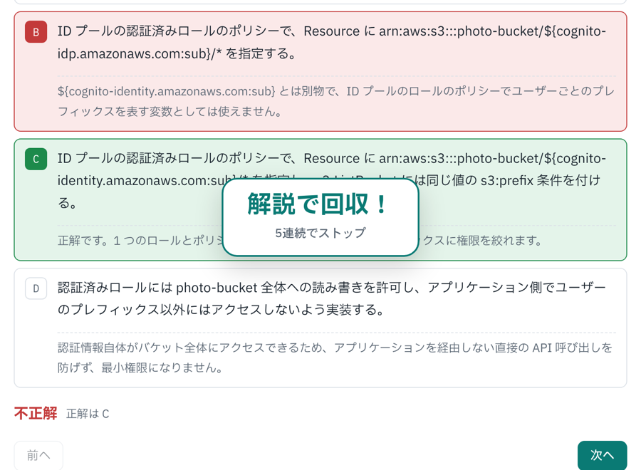
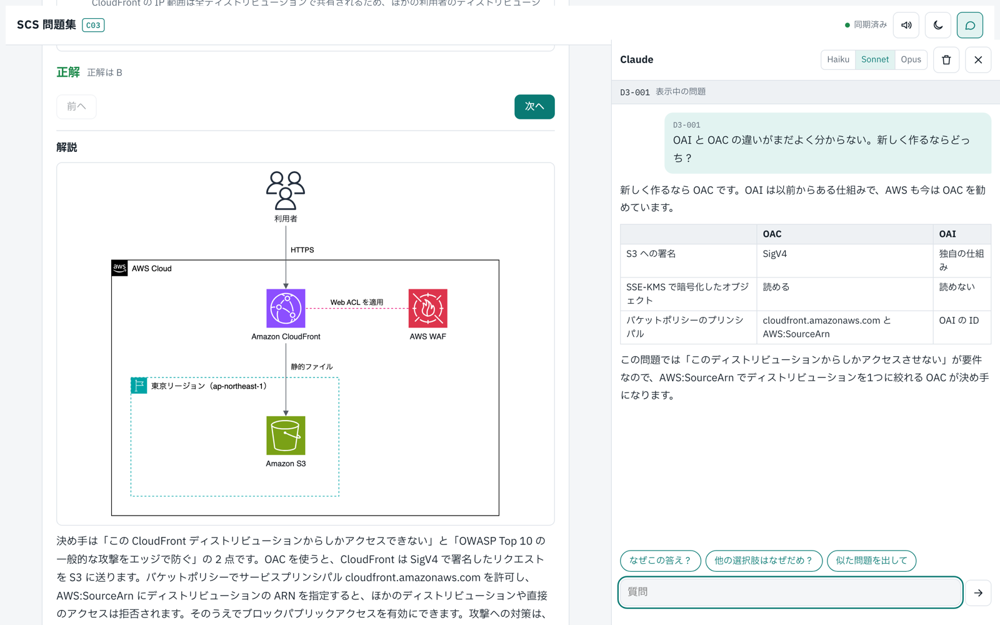
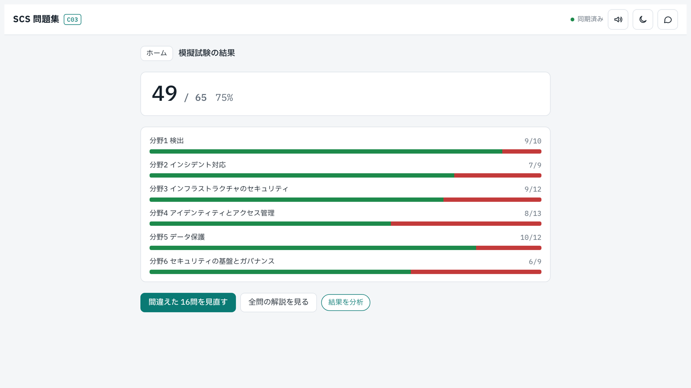
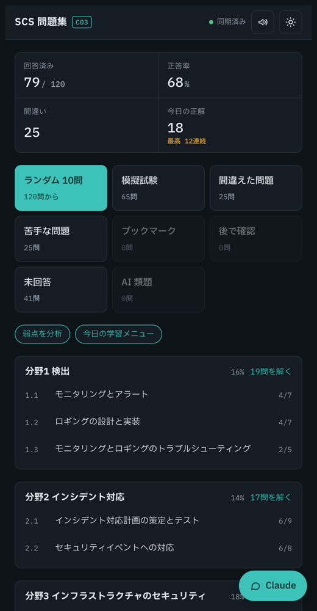

# cert-quiz

資格試験の模擬問題集を Claude に作らせ、自分用の Web ページ(Claude Artifact)として公開するための雛形。問題を書くのも、裏を取るのも、見直すのも Claude で、人は頼む文を送って結果を確かめる。

```text
○○試験の問題集を作って
```

clone したフォルダで Claude Code に試験名を伝えれば始まる。Claude はリポジトリの [`CLAUDE.md`](CLAUDE.md) を読んで進め方を知っているので、ほかの指示は要らない。途中で何が起きて、人がどこを確かめるかは [`docs/guide.md`](docs/guide.md) にある。

## できあがるページ

画像は作例の SCS-C03 で、説明のために回答履歴やチャットの中身を入れた状態で撮っている。

### ホーム

回答済みの数、正答率、今日の正解数と最高の連続正解が上に並ぶ。ランダム10問、本番と同じ配分の模擬試験、間違えた問題、苦手な問題、ブックマークからすぐ始められ、分野と細目ごとの進み具合も見える。



### 問題を解く

本番に近いシナリオ問題を、4択の単一選択と5択の複数選択で出す。試験に合わせて、並べ替え、内容一致、1つのシナリオに複数の設問が付くケーススタディも出せる。上の番号で問題を行き来でき、迷った問題には「後で」の印やブックマークを付けられる。右上の炎は今の連続正解の数。



### 解説と構成図

答えると、選択肢ごとに正解の理由と不正解の理由が出る。解説には構成図と、裏取りに使った公式ページへのリンクが付く。



### 正解したとき、連続正解、間違えたとき

正解すると効果音と紙吹雪と褒め言葉が出る。連続正解が伸びるほど太鼓の連打が入り、紙吹雪も増える。間違えたときも「ドンマイ！」のような一言が出て、続いていた連続正解の数を教えてくれる。音は正解と不正解でそれぞれ何種類かあり、毎回変わる。

<table>
<tr>
<td></td>
<td></td>
<td></td>
</tr>
<tr>
<td align="center">正解</td>
<td align="center">7連続正解</td>
<td align="center">不正解</td>
</tr>
</table>

### Claude に質問する

解説の横のチャットで、表示中の問題について Claude に聞ける。答えるモデルは Haiku、Sonnet、Opus から選べ、チャット欄の幅は縁をドラッグして変えられる。「似た問題を出して」と頼むと同じ論点の類題を作り、回答履歴から弱点を分析して練習セットを開くこともできる。チャットと類題作りは、開いた人の claude.ai の使用量を使う。



### 模擬試験の結果、スマホとダークモード

模擬試験は分野ごとの正答率で結果が出て、間違えた問題だけをすぐ見直せる。回答履歴は claude.ai のアカウントに保存され、パソコンとスマホのどちらで開いても続きから解ける。

<table>
<tr>
<td width="72%"></td>
<td width="28%"></td>
</tr>
</table>

## 作例

| 試験 | 問題数 |
|---|---|
| AWS Certified Security - Specialty (SCS-C03) | 120 |

作者が自分用に作ったもの。問題、ルール、見直しの手順は [`exams/aws-scs-c03/`](exams/aws-scs-c03/) にある。公開した Artifact は作者だけが開ける設定なので、解きたいときは自分でビルドして公開してほしい。

この問題は Claude が AWS の公式ドキュメントで裏を取りながら書いたオリジナルで、本番の試験問題や市販の問題集から写したものではない。見直しはしているが、誤りが残っているかもしれない。気づいたら Issue で教えてほしい。

AWS の公式の教材ではなく、Amazon Web Services とは関係がない。AWS、各サービス名、試験名は Amazon.com, Inc. またはその関連会社の商標。

[LICENSE](LICENSE) の MIT はこのリポジトリのコードと文章に適用する。構成図の SVG に含まれる AWS のアイコンは対象外で、[AWS Architecture Icons](https://aws.amazon.com/architecture/icons/) の条件に従う。

## 構成

```text
CLAUDE.md                問題集を作るときに Claude が読む進め方
docs/guide.md            人が読む手順。各段で Claude に送る文が載っている
build.py                 試験IDを受け取り、検証して dist/<試験ID>/index.html を作る
template/index.html      全試験で共通のページ(出題、履歴の同期、チャット、効果音)
template/exam/           新しい試験の雛形。exams/ の下に写して使う
exams/<試験ID>/
  exam.json              試験名、分野と配点、模擬試験の問題数、Claude への指示、公開先
  questions/*.json       問題。ファイルの分け方は自由
  diagrams/<問題ID>.svg   解説に載せる構成図(任意)
  BRIEF.md               問題を作るときのルール
  REVIEW.md              問題を見直すときの手順
```

## ビルド

```sh
python3 build.py aws-scs-c03
```

[`build.py`](build.py) を動かすと、件数、分野ごとと形式ごとの内訳、単一選択の正解位置の分布が出る。形式の誤り(選択肢の数、正解の添字、ケーススタディのシナリオの有無、[`exam.json`](exams/aws-scs-c03/exam.json) に無い細目、ID の重複など)があると NG を出して止まる。Python 3 の標準ライブラリだけで動く。

できた `dist/<試験ID>/index.html` はブラウザでそのまま開ける。回答の保存と Claude のチャットは、Artifact として公開したときだけ使える。公開のしかたは [`docs/guide.md`](docs/guide.md) の6と7にある。

## SCS-C03 の構成図

SCS-C03 の構成図は、作者が手元で使っている非公開のツール archwire で描いている。`diagrams/<問題ID>.yaml` がその定義で、1行目のコメントが図の説明(読み上げ用)になる。問題文に無い部品を足したときは「# 補った部品: ALB、ECS」の行を足すと、図の下に小さく出る。SVG はリポジトリに入れてあるので、図を描き直さないかぎり archwire は要らない。

```sh
cd exams/aws-scs-c03/diagrams
archwire compile D3-001.yaml -o D3-001.drawio
drawio -x -f svg -o D3-001.svg D3-001.drawio
```

archwire は利用者か、検出のサービス(GuardDuty、Inspector、Security Hub、Config、CloudTrail、EventBridge、CloudWatch)を起点に描く。S3 だけ、Cognito だけのような問題や、Organizations、IAM の関係図は描けない。リージョンは東京だけなので、別のリージョンが正解の決め手になる問題には図を付けない。`.drawio` と診断の JSON は Git に入れない。

## ライセンス

コードも問題も [MIT License](LICENSE) で公開している。
